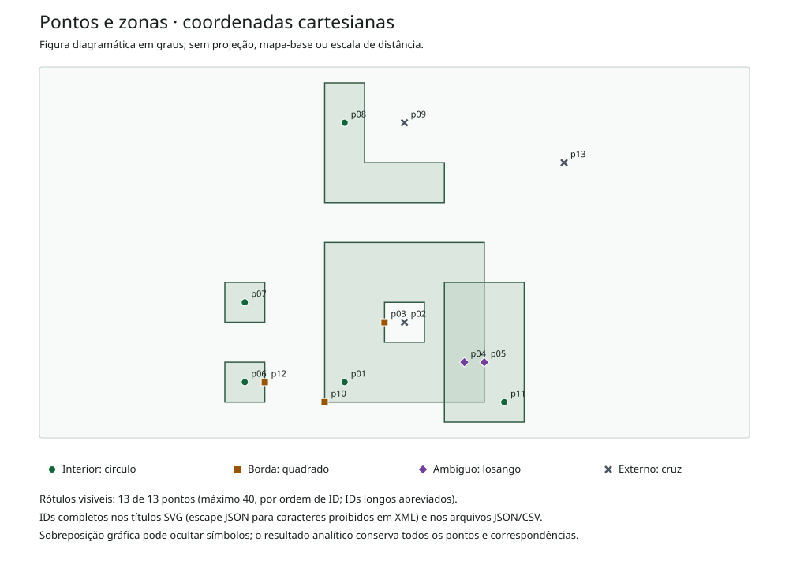

# Zonas GeoJSON

Descubra em quais áreas de atendimento seus pontos já geocodificados estão. O Zonas GeoJSON cruza duas coleções locais, distingue interior e fronteira, respeita furos e ilhas e conserva todas as correspondências quando há sobreposição. Nenhuma zona vencedora é escolhida silenciosamente.

CLI e biblioteca Python da [LOFRANO TECNOLOGIA](https://lofranotecnologia.com.br/), em português, sob [licença MIT](LICENSE). O cálculo usa racionais derivados dos decimais de entrada; a execução não precisa de servidor, rede, conta ou dependências de terceiros.



## Experimentar

Requer Python 3.11 ou posterior. Crie um ambiente e instale a fonte:

```sh
git clone https://github.com/martinlofranodeoliveira/zonas-geojson.git
cd zonas-geojson
python -m venv .venv
```

No Linux/macOS:

```sh
.venv/bin/python -m pip install .
.venv/bin/zonas-geojson exemplo --saida exemplo-zonas.zip
```

No Windows:

```powershell
.venv\Scripts\python -m pip install .
.venv\Scripts\zonas-geojson exemplo --saida exemplo-zonas.zip
```

A instalação compila o pacote usando o backend indicado no projeto. Depois de instalado, o comando de análise usa somente a biblioteca padrão. A [versão 1.0.0](https://github.com/martinlofranodeoliveira/zonas-geojson/releases/tag/v1.0.0) também oferece wheel, fonte, exemplo completo e checksums.

Descompacte o exemplo e abra `mapa.svg` e `LEIA-ME.md`. São 13 pontos e quatro zonas fictícias: cinco pontos internos a uma zona, três na fronteira de uma zona, dois ambíguos e três externos. O ponto dentro do furo fica externo; a fronteira do furo conta como fronteira da zona. Há 12 correspondências no total.

## Analisar seus arquivos

```sh
zonas-geojson analisar pontos.geojson zonas.geojson --saida resultado.zip
```

Os pontos precisam ser `Point` 2D; as zonas, `Polygon` ou `MultiPolygon`, em duas `FeatureCollection`. Cada feição tem `id` textual único e `properties` como objeto. As posições seguem longitude, latitude em graus. O [formato aceito](docs/FORMATO.md) e a [API](docs/API.md) detalham o recorte e as recusas.

O ZIP novo contém os dois arquivos originais, resultado JSON, correspondências CSV, pontos anotados GeoJSON, mapa SVG, orientação e manifesto SHA-256. Um destino existente é preservado. A publicação usa hardlink exclusivo e exige um sistema de arquivos que ofereça essa operação; a ferramenta recusa o destino quando essa garantia não está disponível.

| Estado do ponto | Significado |
| --- | --- |
| `inside` | Interior de exatamente uma zona |
| `boundary` | Fronteira de exatamente uma zona, incluindo anéis de furos |
| `ambiguous` | Duas ou mais zonas correspondem, por interior ou fronteira |
| `outside` | Nenhuma zona corresponde |

Um ponto ambíguo também pode estar em uma fronteira; `pointsWithBoundary` informa essa ocorrência separadamente. O CSV tem uma linha por correspondência e uma linha para cada ponto externo. Campos `zg_*` nos pontos anotados permitem revisar os resultados em ferramentas GIS; as propriedades originais são conservadas e colisões com esses nomes são recusadas.

## Precisão e limites

Os segmentos são cartesianos nas coordenadas fornecidas, como descrito no [RFC 7946](https://datatracker.ietf.org/doc/html/rfc7946#section-3.1.1). O motor não calcula áreas ou distâncias geodésicas, não geocodifica endereços e não determina a exatidão territorial dos dados. Não usa epsilon ou arredondamento para decidir fronteiras.

O recorte aceita polígonos simples, furos estritamente internos e componentes separados de MultiPolygon. A orientação dos anéis pode variar. Anéis que atravessariam o antimeridiano, altitude, CRS alternativo, geometria nula e membros GeoJSON fora do esquema documentado são recusados. Zonas de feições diferentes podem se tocar e sobrepor.

Limites: 10.000 pontos, 100 zonas, 5.000 posições de zonas, 100.000 correspondências e 8 MiB por documento de entrada. Coordenadas aceitam até 18 casas decimais normalizadas. O orçamento padrão é de 2.000.000 testes lógicos, configurável até 20.000.000:

```sh
zonas-geojson analisar pontos.geojson zonas.geojson --saida resultado.zip --max-checks 5000000
```

O orçamento abrange validação topológica e localização de pontos; não é promessa de tempo ou RAM. Uma recusa não publica um relatório parcial. Os limites separados dos relatórios estão em [FORMATO.md](docs/FORMATO.md).

## Desenvolver e conferir

```sh
python -m pip install . -r requirements-build.txt
python -m unittest discover -s tests -v
python -m build
python scripts/check_distribution.py --dist dist
```

Os testes do núcleo usam casos literais, propriedades geométricas e precisão decimal. Os leitores independentes conferem os arquivos produzidos sem importar a implementação. O procedimento com Shapely/GEOS e Fiona/GDAL está em [INTEROPERABILIDADE.md](docs/INTEROPERABILIDADE.md); as instruções de distribuição estão em [VERIFICACAO.md](docs/VERIFICACAO.md).

Para contribuir, use um cenário sintético pequeno que exponha o comportamento, inclua o resultado esperado e execute os testes relevantes. Não é preciso alterar o formato público para corrigir uma fronteira: preserve IDs, propriedades e a distinção entre resultado e evidência.
